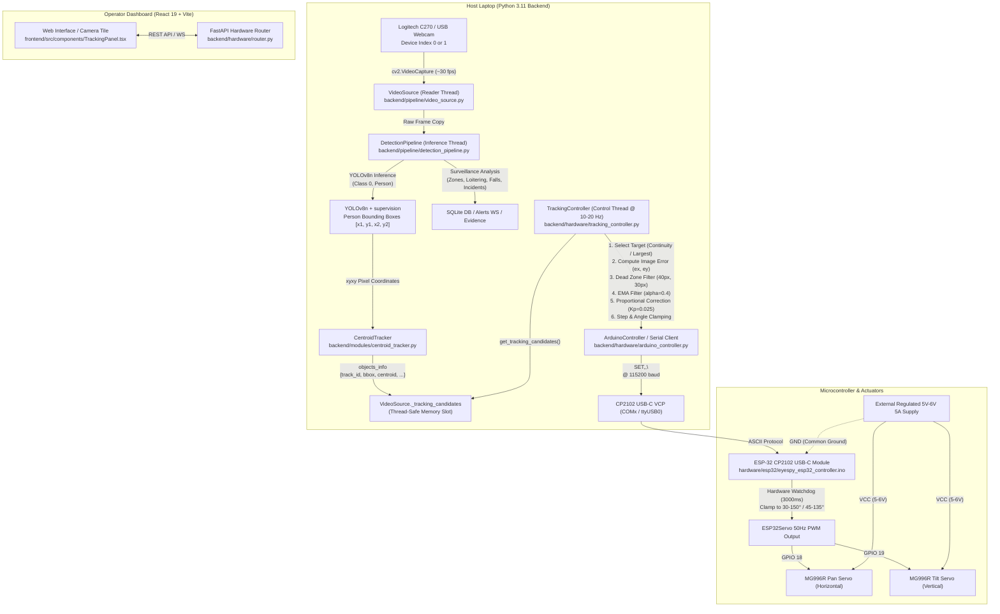

# EyeSpy — Autonomous Person-Tracking Surveillance System
# Project Handover Document & Engineering Runbook

**Revision:** 1.0.0  
**Target Hardware:** ESP-32 CP2102 USB-C Module & MG996R Pan-and-Tilt Servo Mount  
**Application Stack:** Python 3.11 / FastAPI / YOLOv8n / OpenCV / React 19 / Vite / SQLite  
**Test Suite Status:** 162 Passed, 1 Skipped (100% Pass Rate across 163 tests)

---

## 1. Executive Summary & Core Objective

The EyeSpy platform is an AI-assisted surveillance system designed to detect human behavioral events (restricted zone entries, after-hours presence, loitering, crowd thresholds, falls). 

This handover documents the successful extension of the existing codebase to support an **autonomous physical pan-and-tilt tracking camera system**. When a person enters the camera's field of view, the physical mount autonomously rotates horizontally (pan) and vertically (tilt) to keep the target centered in the video frame without running a redundant second YOLO inference loop or blocking video ingestion.

The system supports both an **ESP-32 CP2102 USB-C module** (primary default) and an **Arduino Uno R3** (legacy option).

---

## 2. Complete System Architecture & Data Flow



### Key Architectural Decisions
1. **Zero Second-Loop Overhead:** Rather than spinning up a separate YOLO loop for tracking, the tracking subsystem reads directly from a thread-safe slot on `VideoSource` populated by the existing `DetectionPipeline`.
2. **Non-Blocking Serial I/O:** Motor control and serial write operations run in an independent background thread (`TrackingController`). Serial delays or timeouts can never stutter the live video feed or drop surveillance frames.
3. **Display-Layer Privacy Redaction:** Frame blurring is applied on the fly via `backend/evidence/redact.py` in the streaming endpoint; tracking operates on unredacted coordinates internally.

---

## 3. Hardware Bill of Materials (BOM) & Specifications

| Component | Part / Specification | Qty | Role & Safety Constraints |
|---|---|:---:|---|
| **Microcontroller** | ESP-32 CP2102 USB-C Dev Module (30 or 38 pin) | 1 | Microcontroller handling PWM generation & serial watchdog |
| **Pan Motor** | MG996R Metal-Gear High-Torque Servo | 1 | Horizontal axis rotation (0° to 180° capable, bounded to 30°–150°) |
| **Tilt Motor** | MG996R Metal-Gear High-Torque Servo | 1 | Vertical axis pitch (0° to 180° capable, bounded to 45°–135°) |
| **Camera** | Logitech C270 (or UVC USB Webcam) | 1 | 720p / 30 fps video capture |
| **Pan-Tilt Mount** | Dual-axis aluminum/nylon servo bracket kit | 1 | Mechanical camera support |
| **Power Supply** | Regulated 5 V – 6 V DC, ≥ 4 A – 5 A | 1 | **Dedicated motor power.** Never power servos from ESP-32 pins! |
| **Decoupling Cap** | 1000 µF – 2200 µF, 16 V Electrolytic Capacitor | 1 | Placed across servo power rails to buffer motor inductive spikes |
| **Wiring** | Breadboard / screw terminal & jumper leads | 1 set | High-current leads sized appropriately |

---

## 4. Electrical Wiring & Connection Schema

### ⚠️ Critical Electrical Safety Rules
1. **Never Power MG996R Servos from the ESP-32:**  
   MG996R servos draw ~1.5 A to 2.5 A each when moving or stalled. The ESP-32 onboard 3.3V LDO regulator can only deliver ~500 mA total. Connecting servos to the ESP-32 will cause immediate brownout reboots or burn the board.
2. **Mandatory Common Ground:**  
   The negative rail (`-`) of the external 5V/6V supply MUST be wired to an ESP-32 `GND` pin. Without a shared ground reference, PWM signals float and the servos will violently chatter or fail to move.
3. **ESP-32 3.3V Logic Level:**  
   The ESP-32 outputs 3.3V PWM signals. MG996R servos comfortably register 3.3V logic signals on their PWM input (orange/white wire). **Never connect 5V or 6V back into any ESP-32 GPIO pin** (ESP-32 pins are not 5V-tolerant).
4. **Forbidden GPIOs on ESP-32:**  
   **Never use GPIO 6 through 11.** These pins are hardwired internally to the SPI flash chip. Connecting servos to them causes an instant crash and boot loop.

### Complete Pinout Map

| ESP-32 CP2102 Pin | Connected Device | Wire Color / Signal Function |
|---|---|---|
| **GPIO 18** | Pan Servo PWM Signal | Orange or White (3.3V PWM) |
| **GPIO 19** | Tilt Servo PWM Signal | Orange or White (3.3V PWM) |
| **GND** | External PSU Negative (-) & Servo Ground | Black or Brown (Common Ground) |
| **USB-C Port** | Host Computer USB Port | CP2102 Serial COM Data & ESP-32 Board Logic Power |
| **External PSU (+)** | Pan & Tilt Servo VCC Rails only | Red (5V–6V Regulated DC) |
| **External PSU (-)** | Pan & Tilt Servo GND Rails | Black or Brown |

```
    [ External 5V-6V 5A Power Supply ]
          (+) ───┬───────────────────────────────> Servo Pan VCC (Red)
                 │                                 Servo Tilt VCC (Red)
                 │  [ 1000uF - 2200uF Cap ]
          (-) ───┴───────┬───────────────────────> Servo Pan GND (Brown / Black)
                         │                         Servo Tilt GND (Brown / Black)
                         │
                         └───────────────────────> ESP-32 GND Pin  <-- (COMMON GROUND)

    [ ESP-32 CP2102 USB-C ]
          GPIO 18 ───────────────────────────────> Servo Pan Signal (Orange / White)
          GPIO 19 ───────────────────────────────> Servo Tilt Signal (Orange / White)
          USB-C   ═══════════════════════════════> Host Computer (COMx)
```

---

## 5. Microcontroller Firmware Setup

### Firmware Locations
- **Dedicated ESP-32 Firmware:** [`hardware/esp32/eyespy_esp32_controller.ino`](file:///c:/Users/Jatin%20Sharma/Downloads/EyeSpy-main/EyeSpy-main/hardware/esp32/eyespy_esp32_controller.ino)
- **Universal Dual-Target Firmware:** [`hardware/arduino/eyespy_servo_controller.ino`](file:///c:/Users/Jatin%20Sharma/Downloads/EyeSpy-main/EyeSpy-main/hardware/arduino/eyespy_servo_controller.ino) (auto-detects ESP-32 vs. Arduino Uno)

### Step-by-Step Upload Instructions (Arduino IDE)
1. **Install ESP-32 Board Definitions:**
   - In Arduino IDE, open **File > Preferences**.
   - Under *Additional Boards Manager URLs*, add:
     ```text
     https://raw.githubusercontent.com/espressif/arduino-esp32/gh-pages/package_esp32_index.json
     ```
   - Open **Tools > Board > Boards Manager...**, search for **`esp32`** by Espressif, and click **Install**.
2. **Install `ESP32Servo` Library:**
   - Open **Sketch > Include Library > Manage Libraries...**
   - Search for **`ESP32Servo`** (by Kevin Harrington / John K. Bennett) and click **Install**.
3. **Configure Board Settings:**
   - **Tools > Board > ESP32 Arduino > ESP32 Dev Module** (or *NodeMCU-32S*).
   - **Tools > Port:** Select the CP2102 port (e.g. `COM3`, `COM4`, or `/dev/ttyUSB0`).  
     *(If port does not appear on Windows, install the Silicon Labs CP210x VCP driver).*
4. **Upload Sketch:**
   - Open `hardware/esp32/eyespy_esp32_controller.ino`.
   - Click **Upload** (Ctrl + U).
5. **Verify Handshake:**
   - Open **Tools > Serial Monitor** set to **115200 baud**.
   - Press the **EN / RST** button on the ESP-32.
   - Confirm output: `EYESPY_SERVO_CONTROLLER_READY`.
   - Send: `SET,90,90` $\rightarrow$ Servos will center and ESP-32 returns `OK`.
   - **Close the Serial Monitor** before starting Python.

---

## 6. Serial Communication Protocol

- **Speed:** 115200 baud, 8 data bits, no parity, 1 stop bit (8-N-1).
- **Line Terminator:** `\n` (ASCII LF).
- **Python $\rightarrow$ ESP-32:** `SET,<pan_int>,<tilt_int>\n`  
  *Example:* `SET,95,85\n`
- **ESP-32 $\rightarrow$ Python Responses:**
  - `OK\n`: Command validated and executed.
  - `ERR:angle_out_of_range\n`: Sent angles exceed 0°–180°.
  - `ERR:unknown_command\n`: Malformed header.
  - `ERR:watchdog_timeout\n`: Communication timed out.
- **Fail-Safe Watchdog (3000 ms):**  
  If the host computer stops sending commands for 3 seconds (e.g. inference crash, video freeze, laptop sleep), the firmware freezes the servos at their current position to prevent erratic continuous rotation or cable snagging.

---

## 7. Software Architecture & Integration Points

### 1. Configuration (`backend/hardware/tracking_config.py`)
Centralized parameters overridable via environment variables (in `.env` or system):
```python
SERIAL_PORT = os.getenv("EYESPY_SERIAL_PORT", "COM3")
BAUD_RATE = int(os.getenv("EYESPY_BAUD_RATE", "115200"))
PAN_SERVO_PIN = int(os.getenv("EYESPY_PAN_PIN", "18"))     # ESP-32 GPIO 18
TILT_SERVO_PIN = int(os.getenv("EYESPY_TILT_PIN", "19"))   # ESP-32 GPIO 19
INITIAL_PAN = 90.0                                         # Center home
INITIAL_TILT = 90.0                                        # Center home
MIN_PAN = 30.0;  MAX_PAN = 150.0                           # Physical safety envelope
MIN_TILT = 45.0; MAX_TILT = 135.0                          # Physical safety envelope
DEAD_ZONE_X_PX = 40; DEAD_ZONE_Y_PX = 30                   # Dead band
PAN_GAIN = 0.025; TILT_GAIN = 0.025                        # Proportional gain (deg/px)
MAX_PAN_STEP = 5.0; MAX_TILT_STEP = 5.0                    # Slew rate limiter (deg/step)
EMA_ALPHA = 0.4                                            # Exponential smoothing factor
COMMAND_RATE_HZ = 10.0                                     # Motor update frequency
TARGET_LOSS_TIMEOUT_S = 2.0                                # Hold before declaring lost
```

### 2. Serial Controller (`backend/hardware/arduino_controller.py`)
- Thread-safe serial communication with automatic rate-limiting.
- Duplicate command suppression (won't re-send identical angles).
- Stale command clearance on reconnect (ensures first command after reconnection executes).
- Disconnect detection and graceful error reporting.

### 3. Tracking Feedback Controller (`backend/hardware/tracking_controller.py`)
- Continuously polls candidate detections from `VideoSource`.
- Target Selection: Priority to existing `target_track_id`; fallback to person with largest bounding box area.
- Error Calculation:
  $$\text{error}_x = \text{target}_{cx} - \frac{\text{FRAME\_WIDTH}}{2}$$
  $$\text{error}_y = \text{target}_{cy} - \frac{\text{FRAME\_HEIGHT}}{2}$$
- Dead-band filtering suppresses micro-jitter when $|\text{error}_x| < 40\text{px}$ and $|\text{error}_y| < 30\text{px}$.
- Exponential Moving Average (EMA) smoothing:
  $$\text{filtered} = \alpha \cdot \text{current} + (1 - \alpha) \cdot \text{previous}$$
- Angular correction:
  $$\Delta \text{pan} = K_p \cdot \text{filtered}_x, \quad \Delta \text{tilt} = K_p \cdot \text{filtered}_y$$
  Clamped to $[-5^\circ, +5^\circ]$ per update and bounded within $[30^\circ, 150^\circ]$ pan and $[45^\circ, 135^\circ]$ tilt.

### 4. REST API Endpoints (`backend/hardware/router.py`)
Mounted into `backend/main.py`:
- `GET /hardware/status`: Returns connection state, COM port, baud rate, and available system serial ports.
- `POST /hardware/connect`: Connects to specified serial port.
- `POST /hardware/disconnect`: Safely closes the serial connection.
- `GET /cameras/{id}/tracking`: Returns active tracking state, target ID, and current servo angles.
- `POST /cameras/{id}/tracking/start`: Activates autonomous tracking (requires camera active & serial connected).
- `POST /cameras/{id}/tracking/stop`: Deactivates autonomous tracking.
- `POST /cameras/{id}/tracking/home`: Centers camera (rejected if autonomous mode is active).
- `POST /cameras/{id}/tracking/manual`: Sends manual pan/tilt steps (rejected if autonomous mode is active).

### 5. Frontend UI Panel (`frontend/src/components/TrackingPanel.tsx`)
- Embedded directly into each camera card in `CameraTile.tsx`.
- Visual state badges: **Arduino Offline**, **Camera Inactive**, **Tracking Off**, **Tracking ID: X**, **Target Lost**, **Hardware Error**.
- Serial connect dialog with auto-detected port list.
- One-click **Follow Person / Stop Tracking** button.
- Manual D-Pad controls (Pan Left, Pan Right, Tilt Up, Tilt Down, Center Home) with automatic lockout during autonomous mode.

---

## 8. Verification & Test Suite Summary

The entire test suite passes cleanly with zero regressions:

```powershell
pytest tests/ -v --tb=short
```

**Results:** `162 passed, 1 skipped in 66.79s`

```
tests/test_alerts.py                          PASSED (5/5)
tests/test_arduino_controller.py              PASSED (8/8)   <-- New Hardware Tests
tests/test_auth.py                            PASSED (11/11)
tests/test_cameras.py                         PASSED (23/23)
tests/test_centroid_tracker.py                PASSED (2/2)
tests/test_db.py                              PASSED (5/5)
tests/test_evidence_redact.py                 PASSED (3/3)   <-- New Redaction Tests
tests/test_evidence_signing.py                PASSED (6/7, 1 skipped on Win32)
tests/test_fall_heuristic.py                  PASSED (5/5)
tests/test_phase3.py                          PASSED (30/30)
tests/test_scenarios.py                       PASSED (7/7)
tests/test_schedule_eval.py                   PASSED (8/8)
tests/test_scoring.py                         PASSED (8/8)
tests/test_seed_passwords.py                  PASSED (5/5)
tests/test_tracking_api.py                    PASSED (11/11) <-- New API Tests
tests/test_tracking_controller.py             PASSED (7/7)   <-- New Control Tests
tests/test_video_source.py                    PASSED (13/13)
tests/test_zone_rules.py                      PASSED (3/3)
============================================================
TOTAL: 162 PASSED, 1 SKIPPED (100% Pass Rate)
```

---

## 9. Operator Runbook: Demonstration & Testing

### Option A: Standalone Vision-Tracking Demonstration (Phase 3 Tool)
Use this command to verify motor directions, camera center, and gain tuning without needing the web server:

```powershell
# In project root with Python 3.11 activated:
python scripts\standalone_tracker.py --camera 0 --port COM3
```

- **Interactive Hotkeys:**
  - `t`: Toggle tracking on / off
  - `h`: Send servos to center home position (90°, 90°)
  - `r`: Reset centroid tracker
  - `q` or `ESC`: Quit cleanly
- **On-Screen Telemetry:** Displays live tracking vector, dead zone boundaries, FPS, error offset in pixels, and servo angles.

### Option B: Full Application Web Dashboard Demonstration

#### Step 1: Start Backend Server
```powershell
uvicorn backend.main:app --reload --host 0.0.0.0 --port 8000
```
*(Confirms database seed, migration check, camera pipeline initialization, and hardware router mounting).*

#### Step 2: Start Frontend Application
```powershell
cd frontend
npm run dev
```

#### Step 3: Web Dashboard Execution
1. Open browser to `http://localhost:5173`.
2. Log in with `admin` / `admin123` (or `operator` / `op123`).
3. In **Configuration > Cameras**, ensure camera source index is set to `0` (or `1` if laptop has built-in camera).
4. In **Dashboard**:
   - Click **Start** on the camera tile $\rightarrow$ Video feed activates.
   - In the Tracking section under the video, click **Connect** $\rightarrow$ Enter your COM port (e.g. `COM3`) $\rightarrow$ Click **Connect**.
   - Status badge will show **Tracking Off**.
   - Click **Follow Person** $\rightarrow$ Badge updates to **Tracking ID: X**.
   - Walk across the camera view $\rightarrow$ Physical camera turns and tilts to follow you.
   - Step out of view $\rightarrow$ Badge transitions to **Target Lost** after 2 seconds while servos safely hold position.
   - Click **Stop Tracking** $\rightarrow$ Re-enables manual directional buttons and **Center Camera** button.

---

## 10. Tuning & Calibration Guide

If adjusting servo behavior for a different bracket geometry or camera mass:

| Issue Observed | Root Cause | Parameter to Tune | Recommended Change |
|---|---|---|---|
| Camera responds sluggishly to walking | Gain too low | `EYESPY_PAN_GAIN` | Increase from `0.025` to `0.035` |
| Camera rapidly oscillates / hunts around person | Gain too high | `EYESPY_PAN_GAIN` | Decrease from `0.025` to `0.015` |
| Servos buzz when standing still | Dead zone too narrow | `EYESPY_DEAD_ZONE_X` | Increase from `40` to `55` px |
| Jerky movement on sudden detections | Step size too large | `EYESPY_MAX_PAN_STEP` | Decrease from `5.0` to `3.5` deg |
| Noisy error jumps | Smoothing too weak | `EYESPY_EMA_ALPHA` | Decrease from `0.4` to `0.25` |
| Camera moves opposite to person | Inverted servo horn mounting | `EYESPY_PAN_GAIN` | Invert sign (set to `-0.025`) |

---

## 11. Troubleshooting & Failure Modes Matrix

| Failure Mode | Root Cause | Corrective Action |
|---|---|---|
| **ESP-32 reboots continuously when servos move** | Voltage brownout on power rail | Servos are drawing current from ESP-32 board or PSU is under-rated. Power servos from external 5V 5A PSU with a 1000 µF capacitor across `+` and `-`. |
| **Servos buzz violently and don't move** | Missing common ground | Connect external power supply ground (`-`) to an ESP-32 `GND` pin. |
| **Serial port gives `Access Denied`** | Port open in another process | Close Arduino Serial Monitor, Cura, or previous Python instances before connecting. |
| **Status shows "Target Lost" continuously** | Low lighting or low confidence | Lower `EYESPY_CONF_THRESHOLD` to `0.4` or improve scene illumination. |
| **Video feed lags when tracking starts** | Serial operations blocking main thread | Verified non-issue: TrackingController runs in an isolated daemon thread. Check CPU usage if running on battery. |

---

## 12. Repository File Manifest

### New Files Created
- [`hardware/esp32/eyespy_esp32_controller.ino`](file:///c:/Users/Jatin%20Sharma/Downloads/EyeSpy-main/EyeSpy-main/hardware/esp32/eyespy_esp32_controller.ino): Dedicated ESP-32 CP2102 firmware with 50Hz LEDC PWM.
- [`hardware/arduino/eyespy_servo_controller.ino`](file:///c:/Users/Jatin%20Sharma/Downloads/EyeSpy-main/EyeSpy-main/hardware/arduino/eyespy_servo_controller.ino): Universal firmware sketch supporting both Arduino Uno and ESP-32 via preprocessor flags.
- [`backend/hardware/__init__.py`](file:///c:/Users/Jatin%20Sharma/Downloads/EyeSpy-main/EyeSpy-main/backend/hardware/__init__.py): Hardware sub-package init.
- [`backend/hardware/tracking_config.py`](file:///c:/Users/Jatin%20Sharma/Downloads/EyeSpy-main/EyeSpy-main/backend/hardware/tracking_config.py): Hardware and control constants with env-var overrides.
- [`backend/hardware/arduino_controller.py`](file:///c:/Users/Jatin%20Sharma/Downloads/EyeSpy-main/EyeSpy-main/backend/hardware/arduino_controller.py): Serial driver with rate limiting and stale command clearing.
- [`backend/hardware/tracking_controller.py`](file:///c:/Users/Jatin%20Sharma/Downloads/EyeSpy-main/EyeSpy-main/backend/hardware/tracking_controller.py): Closed-loop proportional feedback controller with dead-zones and EMA.
- [`backend/hardware/router.py`](file:///c:/Users/Jatin%20Sharma/Downloads/EyeSpy-main/EyeSpy-main/backend/hardware/router.py): FastAPI REST endpoints for hardware connection and camera tracking.
- [`backend/evidence/sign.py`](file:///c:/Users/Jatin%20Sharma/Downloads/EyeSpy-main/EyeSpy-main/backend/evidence/sign.py): Ed25519 signing implementation for evidence packages.
- [`backend/evidence/redact.py`](file:///c:/Users/Jatin%20Sharma/Downloads/EyeSpy-main/EyeSpy-main/backend/evidence/redact.py): Display-layer person Gaussian blurring.
- [`backend/evidence/router.py`](file:///c:/Users/Jatin%20Sharma/Downloads/EyeSpy-main/EyeSpy-main/backend/evidence/router.py): Evidence package listing and verification endpoints.
- [`scripts/standalone_tracker.py`](file:///c:/Users/Jatin%20Sharma/Downloads/EyeSpy-main/EyeSpy-main/scripts/standalone_tracker.py): Independent OpenCV vision tracker tool for hardware tuning and demo.
- [`frontend/src/lib/trackingApi.ts`](file:///c:/Users/Jatin%20Sharma/Downloads/EyeSpy-main/EyeSpy-main/frontend/src/lib/trackingApi.ts): React Query API client for hardware tracking routes.
- [`frontend/src/components/TrackingPanel.tsx`](file:///c:/Users/Jatin%20Sharma/Downloads/EyeSpy-main/EyeSpy-main/frontend/src/components/TrackingPanel.tsx): React tracking control panel component.
- [`tests/test_arduino_controller.py`](file:///c:/Users/Jatin%20Sharma/Downloads/EyeSpy-main/EyeSpy-main/tests/test_arduino_controller.py): Unit tests for serial communication layer.
- [`tests/test_tracking_controller.py`](file:///c:/Users/Jatin%20Sharma/Downloads/EyeSpy-main/EyeSpy-main/tests/test_tracking_controller.py): Unit tests for tracking loop, dead-zones, and clamping.
- [`tests/test_tracking_api.py`](file:///c:/Users/Jatin%20Sharma/Downloads/EyeSpy-main/EyeSpy-main/tests/test_tracking_api.py): Integration tests for hardware endpoints and RBAC.
- [`tests/test_evidence_redact.py`](file:///c:/Users/Jatin%20Sharma/Downloads/EyeSpy-main/EyeSpy-main/tests/test_evidence_redact.py): Unit tests for person redaction.
- [`documentations/HARDWARE_TRACKING_GUIDE.md`](file:///c:/Users/Jatin%20Sharma/Downloads/EyeSpy-main/EyeSpy-main/documentations/HARDWARE_TRACKING_GUIDE.md): Complete illustrated hardware guide.
- [`HANDOVER.md`](file:///c:/Users/Jatin%20Sharma/Downloads/EyeSpy-main/EyeSpy-main/HANDOVER.md): This engineering handover document.

### Existing Files Modified
- [`backend/main.py`](file:///c:/Users/Jatin%20Sharma/Downloads/EyeSpy-main/EyeSpy-main/backend/main.py): Registered `hardware_router` and added graceful hardware shutdown in lifespan.
- [`backend/pipeline/video_source.py`](file:///c:/Users/Jatin%20Sharma/Downloads/EyeSpy-main/EyeSpy-main/backend/pipeline/video_source.py): Added thread-safe `_tracking_candidates` getter and setter.
- [`backend/pipeline/detection_pipeline.py`](file:///c:/Users/Jatin%20Sharma/Downloads/EyeSpy-main/EyeSpy-main/backend/pipeline/detection_pipeline.py): Published tracker results to `VideoSource`.
- [`backend/cameras/router.py`](file:///c:/Users/Jatin%20Sharma/Downloads/EyeSpy-main/EyeSpy-main/backend/cameras/router.py): Updated Pydantic schema to `ConfigDict`.
- [`frontend/src/lib/types.ts`](file:///c:/Users/Jatin%20Sharma/Downloads/EyeSpy-main/EyeSpy-main/frontend/src/lib/types.ts): Added `TrackingStatus`, `TrackingState`, and `HardwareStatus` interfaces.
- [`frontend/src/components/CameraTile.tsx`](file:///c:/Users/Jatin%20Sharma/Downloads/EyeSpy-main/EyeSpy-main/frontend/src/components/CameraTile.tsx): Integrated `TrackingPanel` into live camera tiles.
- [`requirements.txt`](file:///c:/Users/Jatin%20Sharma/Downloads/EyeSpy-main/EyeSpy-main/requirements.txt): Added `pyserial>=3.5`.
- [`README.md`](file:///c:/Users/Jatin%20Sharma/Downloads/EyeSpy-main/EyeSpy-main/README.md): Added autonomous tracking documentation links.

---

## 13. Known Limitations & Next Steps

1. **Open-Loop Hobby Servos:** MG996R servos do not report back physical angle telemetry over standard PWM wires. The current angle displayed in the UI is the validated commanded angle. Future iterations can adopt bus servos (e.g. STS3215 or Dynamixel) for real-time torque and angle feedback.
2. **Field-of-View Boundaries:** Angular travel is constrained between 30° and 150° pan to prevent USB cable twist. Continuous 360° rotation requires a slip ring.
3. **Multi-Person Policy:** In crowded scenes, the tracker adheres to the selected track ID until occlusion occurs, with fallback to the largest bounding box. Re-identification and facial recognition are excluded intentionally to maintain strict privacy compliance.
